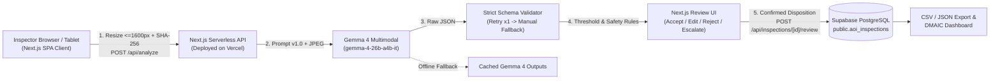

# AOI-Lite Batam: AI-Assisted SMT Inspection

**Human-in-the-Loop, Multimodal Gemma 4 Inspection Assistant & Quality-Record System for SMT/PCBA Manufacturing and SMK Laboratories**

[](LICENSE)
[-blue)](https://ai.google.dev/gemma)
[%20%7C%20Supabase-indigo)](#3-system-architecture)
[](https://events.mlh.com/events/15059-hacktoberfest-hack-day-kota-batam-x-batam-innovation-center)

> [!IMPORTANT]
> **Safety & Positioning Notice:**
> *"AI assistance only. Final quality disposition requires human verification."*
> AOI-Lite Batam is an **inspection-assist and structured quality-documentation tool**. It is **NOT** a replacement for certified Automated Optical Inspection (AOI), Solder Paste Inspection (SPI), X-ray inspection, functional testing, or final quality release. Hidden solder defects (such as BGA/QFN voids and head-in-pillow) cannot be detected optically and require X-ray inspection.

---

## 1. Pitch & Problem Statement

> *"In Batam's electronics supply chain, QC inspectors must check PCBs with hundreds of components and thousands of solder joints. Manual inspection is slow, inconsistent, and difficult to document. Full AOI systems help, but they are expensive and still generate false calls. AOI-Lite Batam gives inspectors a low-cost, human-in-the-loop inspection assistant using Gemma 4. It turns a PCB photo into a structured, traceable quality record while keeping the final quality decision with the human inspector."*

### Why Batam?
Batam is one of Southeast Asia's premier electronics manufacturing hubs (**USD 6.96B** in electronics exports in 2024; ~450 E&E companies employing 85,000–90,000 workers). While Tier-1 EMS facilities operate industrial AOI/SPI/X-ray lines, **Tier-2/Tier-3 suppliers, rework/prototype stations, and SMK electronics training labs** still rely on magnifiers, paper checklists, Excel sheets, and WhatsApp photos—resulting in slow documentation, inconsistent defect taxonomy, and poor traceability.

---

## 2. Key Features & Tech Stack (MVP)

- **Unified Full-Stack Next.js Single-Page Application (SPA):** Built with **Next.js App Router (React, TypeScript, Tailwind CSS)** handling both the responsive Inspector Station SPA (`src/app/page.tsx`) and Serverless Backend Route Handlers (`src/app/api/*`).
- **Cloud Deployment on Vercel:** Zero-CORS, single-project deployment on **Vercel** with client-side HTML5 Canvas image normalization (`<=1600px` JPEG) and Web Crypto SHA-256 hashing.
- **Database (`Supabase`):** **Supabase PostgreSQL** (`public.aoi_inspections`) storing immutable AI outputs, human review dispositions, and DMAIC audit logs, paired with an automatic local JSON fallback for offline resilience.
- **Multimodal Gemma 4 Core (`gemma-4-26b-a4b-it`):** Performs PCB image understanding, visible defect classification, component/board OCR (`visible_labels`), evidence-based explanation, and recommended action generation via the Gemini API.
- **Strict 6-Class Defect Taxonomy:**
  1. `missing_component`
  2. `solder_bridge`
  3. `polarity_error`
  4. `tombstoning`
  5. `component_shift`
  6. `uncertain_or_other`
- **Enforced Human-in-the-Loop Verification:** Inspectors must **Accept**, **Edit**, **Reject** (logged as false call), or **Escalate** every AI suggestion, can add missed defects, and must explicitly choose the final disposition (`pass | rework | quarantine | escalate`).
- **Lean Six Sigma (DMAIC) Dashboard & Exports:** Tracks total inspections, pending human reviews, Defect Pareto distribution, AI precision, false-call rate, recall proxy, traceability completeness, and documentation time, with one-click **CSV** and **JSON** export.

---

## 3. System Architecture



See [docs/architecture.md](docs/architecture.md) for full component, database, and state-machine diagrams.

---

## 4. Quick Start & Vercel Deployment Instructions

### Prerequisites
- Node.js **18+** (tested on Node v22)
- Google AI Studio **Gemini API Key** (`gemma-4-26b-a4b-it`)
- **Supabase** project URL and API key

### Local Development (<= 4 Commands)

```powershell
# 1. Clone the repository and enter the project directory
git clone https://github.com/mhddanial/MLH_Hack.git
cd MLH_Hack
npm install

# 2. Configure environment variables (.env)
Copy-Item .env.example .env
# Fill in GEMINI_API_KEY, SUPABASE_URL, SUPABASE_KEY

# 3. (Optional) Prepare/refresh sample PCB images from dataset
python scripts/prepare_samples.py

# 4. Start the unified Next.js SPA + API server
npm run dev
```

Open **http://localhost:3000** in your browser.

### Deploy to Vercel
1. Push the repository to GitHub and import it into **Vercel** (root directory: `project`).
2. Add the environment variables in Vercel Project Settings:
   - `GEMINI_API_KEY`
   - `GEMMA_MODEL_ID=gemma-4-26b-a4b-it`
   - `CONFIDENCE_THRESHOLD=0.60`
   - `SUPABASE_URL` & `NEXT_PUBLIC_SUPABASE_URL`
   - `SUPABASE_KEY`
   - `SUPABASE_TABLE=aoi_inspections`
3. Click **Deploy** — both the SPA frontend and `/api/*` backend routes deploy together automatically.

---

## 5. Gemma 4 Integration & Strict JSON Schema

- **Model ID:** `gemma-4-26b-a4b-it` (configurable via `GEMMA_MODEL_ID` in `.env`; also supports `gemma-4-31b-it`)
- **Prompt Version:** `aoi-prompt-v1.0` ([`prompts/inspection_prompt_v1.txt`](prompts/inspection_prompt_v1.txt))
- **Schema Version:** `aoi-schema-v1` (`src/lib/schema.ts`)

```json
{
  "board_id": "BAT-PCBA-001",
  "inspection_id": "INS-20261031-120000-a1b2",
  "image_quality": "acceptable | poor | unusable",
  "defects": [
    {
      "defect_class": "missing_component | solder_bridge | polarity_error | tombstoning | component_shift | uncertain_or_other",
      "location_hint": "string",
      "confidence": 0.85,
      "severity": "low | medium | high",
      "evidence": "string",
      "recommended_action": "string"
    }
  ],
  "overall_disposition": "pass | requires_human_verification | rework | quarantine | escalate",
  "visible_labels": ["string"],
  "notes": "string",
  "model": "gemma-4-multimodal",
  "operator_confirmation_required": true
}
```

---

## 6. Lean Six Sigma (DMAIC) & Honest Limitations

See [docs/DMAIC.md](docs/DMAIC.md) for the complete DMAIC breakdown and [sample_data/DATA_SOURCES.md](sample_data/DATA_SOURCES.md) for dataset attribution.

### Known Prototype Limitations
1. **Optical-Only Surface Scope:** Cannot inspect hidden solder joints under BGA, QFN, or LGA packages (voids, head-in-pillow). Those require **X-ray inspection**.
2. **Sample Dataset Scope:** Uses the open Kaggle/PKU bare-PCB defect dataset (`akhatova/pcb-defects`) mapped to the 6-class taxonomy (`Short -> solder_bridge`, bare-board fabrication anomalies -> `uncertain_or_other`, `PCB_USED -> golden pass candidate`) alongside procedural SMT reference cards for the remaining assembly classes.
3. **Assistive Tool Only:** Camera lighting, lens distortion, and resolution affect AI confidence. All outputs require human inspector confirmation.

---

## 7. Hackathon Submission & AI Tool Disclosure

- **Event:** Hacktoberfest Hack Day Kota Batam x Batam Innovation Center (31 October 2026)
- **Prize Categories Targeted:**
  1. **Best Open-Source AI Project**
  2. **Best Use of Gemma 4**
- **Open-Weight AI Model Used:** Google **Gemma 4** (`gemma-4-26b-a4b-it`) accessed via the Google Gemini API (`generateContent`).
- **AI Coding Assistants Disclosure (MLH Transparency Rule):** Built with assistance from Antigravity AI coding assistant (Claude Opus / Gemini models) for rapid full-stack scaffolding, documentation structuring, and schema validation during the 4-hour hackathon build window.
- **Data & Privacy Confirmation:** No confidential customer boards, proprietary schematics, or real operator PII are used in this repository or demo.
- **License:** [MIT License](LICENSE)
