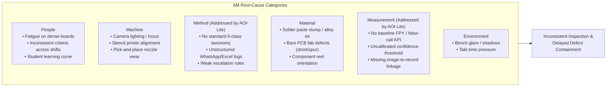

# Lean Six Sigma (DMAIC) Quality Alignment — AOI-Lite Batam

> **Scope Disclaimer:** AOI-Lite Batam demonstrates how structured, human-verified multimodal AI records enable DMAIC quality engineering in small Batam PCBA suppliers and SMK electronics laboratories. It does **not** claim to be a completed factory-wide Six Sigma capability study.

---

## 1. Define — The Inspection Documentation Bottleneck

- **Problem:** In Tier-2/Tier-3 PCBA suppliers and SMK training labs in Batam, visual inspection relies on magnifiers, paper checklists, ad-hoc Excel files, and WhatsApp photos.
- **Pain Points:**
  - High documentation latency (~70 seconds per board in manual benchmarks).
  - Inconsistent defect naming across operators and shifts (`bridge` vs. `short` vs. `solder ball`).
  - Weak traceability: photos are not linked to board ID, revision, operator, timestamp, or final disposition.
  - Conventional AOI machines cost USD 20,000–100,000+ and still suffer high false-call ratios (0.003 to 0.028 true-to-false ratio in industry studies), requiring human verification.
- **Project Goal:** Provide a low-cost, human-in-the-loop inspection assistant powered by **Gemma 4 (`gemma-4-26b-a4b-it`)** that standardizes defect classification into 6 visible classes, enforces human confirmation, and outputs 100% traceable quality records.

---

## 2. Measure — Quantitative KPIs Captured by the Prototype

Every inspection in AOI-Lite Batam automatically measures and logs the following metrics (displayed live on the **Dashboard** tab and exported in CSV/JSON):

| Metric | Operational Formula in AOI-Lite Batam | Prototype Target |
|---|---|---|
| **Inspection Documentation Time (`doc_time_s`)** | `reviewed_at - capture_started_at` (measured automatically by client timer from image selection to human confirmation). | Reduce documentation time by >= 40% vs. manual unstructured typing. |
| **Traceability Completeness (%)** | `% of confirmed records containing non-null: image_sha256, created_at, operator_id, board_id, defect_class/pass, final_disposition, model_id, prompt_version`. | **100%** (enforced by schema & DB constraints). |
| **AI Suggestion Precision (%)** | `Accepted AI Defects / (Accepted + Edited + Rejected AI Defects)` across human-reviewed records. | Reported honestly on the dashboard; never overstated. |
| **AI False-Call Rate (%)** | `Rejected AI Defects / Total AI-Flagged Defects` (measures operator verification burden). | Controlled via `CONFIDENCE_THRESHOLD=0.60` and evidence rules. |
| **AI Recall Proxy (%)** | `Accepted AI Defects / (Accepted + Edited + Human-Added Missed Defects)`. | Reported honestly; highlights bare-PCB vs. SMT limitations. |
| **Human-AI Agreement Rate (%)** | Breakdown of confirmed inspections into `agree`, `partial`, and `disagree`. | Tracks calibration between Gemma 4 and human inspectors. |
| **Rework / Escalation Routing Delay** | Immediate same-screen disposition routing (`rework`, `quarantine`, `escalate`). | Near-zero handoff delay. |

---

## 3. Analyze — Defect Pareto & Root-Cause Decomposition (6M Fishbone)

### 3.1 Automated Stratification & Pareto Analysis
The **Dashboard** and **CSV Export** stratify confirmed defects by:
1. **Defect Class (Pareto Chart):** Identifies the "vital few" defect categories driving rework.
2. **Severity (`high`, `medium`, `low`):** Prioritizes electrical shorts (`solder_bridge`) and missing/reversed parts over minor anomalies.
3. **Line / Station & Shift (`Shift A`, `Shift B`, `Shift C`):** Isolates machine or shift-handover patterns.
4. **Board ID & Revision:** Identifies design-specific DFM/stencil issues.

### 3.2 6M Ishikawa (Fishbone) Root-Cause Linkage

---

## 4. Improve — Workflow Standardization & AI Assistance

1. **Standardized 6-Class Taxonomy:** Eliminates free-text ambiguity by constraining Gemma 4 and inspector edits to `missing_component`, `solder_bridge`, `polarity_error`, `tombstoning`, `component_shift`, and `uncertain_or_other`.
2. **Evidence-Based AI Triage:** Gemma 4 provides `location_hint`, `confidence`, `evidence`, and `recommended_action` in 10–20 seconds so the inspector knows *where* to look and *why*.
3. **Confidence-Based Routing:** Any defect with `confidence < 0.60` or `image_quality != acceptable` is automatically flagged `requires_human_verification` with explicit routing reasons.
4. **Mandatory Human Gate:** The UI blocks record completion until the inspector explicitly reviews each AI flag (`Accept`, `Edit`, `Reject`, `Escalate`) and selects the final disposition.

---

## 5. Control — Governance, Versioning, and Feedback Loop

1. **Golden Sample Library:** Clean reference boards (`PCB_USED`) are retained in the sample gallery to test false-call rates and train SMK students.
2. **Prompt & Model Version Control:** Every record locks `model_id` (`gemma-4-26b-a4b-it`), `prompt_version` (`aoi-prompt-v1.0`), and `prompt_sha` (`SHA-256`).
3. **False-Call Feedback Loop:** Rejected AI suggestions are stored in SQLite with operator notes, creating a local dataset to tune `CONFIDENCE_THRESHOLD` and refine few-shot prompt instructions when new board revisions are introduced.
4. **X-Ray Boundary Enforcement:** Operators are reminded on-screen that BGA/QFN hidden joints cannot be cleared optically and require X-ray verification.
