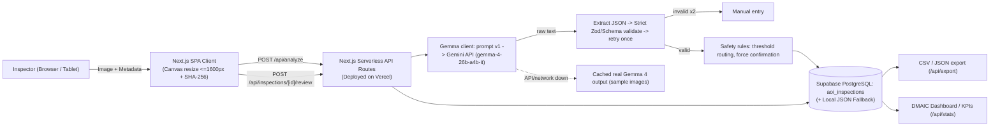

# AOI-Lite Batam: AI-Assisted SMT Inspection — Project Context (Single Source of Truth)

> Sources: `AOI-Lite_Batam_Hackathon_Project_Brief.docx` (30 Oct 2026), the engineering kickoff request, and `docs/CONTEXT.md` (hackathon rules and judging).
> If a document conflicts with this one, **the Project Brief wins**, then this file.

> [!IMPORTANT]
> **Positioning (do not change):** AOI-Lite Batam is an **inspection-assist and quality-documentation tool**. It does **not** replace certified AOI, SPI, X-ray, functional testing, or final quality release.
> UI banner text: **"AI assistance only. Final quality disposition requires human verification."**

---

## 1. Event and constraints

| Item | Value |
|---|---|
| Event | Hacktoberfest Hack Day Kota Batam x Batam Innovation Center |
| Date / venue | Sat 31 Oct 2026, Politeknik Negeri Batam, Technopreneur Centre L2 |
| Build window | **11:00 to 15:00 WIB** (hard stop). Demos 15:00 to 16:00 |
| After 15:00 | Debugging and small fixes only. No new features |
| Prize targets | **Best Open-Source AI Project** (primary), **Best Use of Gemma 4** (secondary) |
| Team | 1 to 2 people. Each registers individually; one person submits |
| Judging (equal weight) | Technology · Design · Completion · Learning |
| Submission | Public GitHub repo (stays public), OSI license, demo video ≤ 2 min that opens with the hackathon name, AI-tool disclosure |
| Rule | All code is written during the event. Libraries and open-source code are allowed. No prior project code is reused |

## 2. Problem statement
- One SMT board has about **500 parts and 1,500 solder terminations**, or **about 2,000 defect opportunities**.
- Small Batam suppliers and SMK labs inspect by hand with magnifiers, paper checklists, Excel, and WhatsApp photos. This is slow, inconsistent, affected by fatigue, and **hard to trace**.
- Full AOI costs **tens of thousands to more than USD 100k** and still produces **false calls**. A Siemens dataset found true-defect : false-call ratios of 0.003 to 0.028, and false calls cost about 10 to 15% of efficiency.
- **Core gap:** there is no affordable, explainable, data-connected inspection layer that helps operators without creating a new false-alarm bottleneck.

## 3. Why Batam
- Electronics exports were USD 6.96B in 2024, about 50% of non-oil exports. There are about 450 E&E companies with 85–90k workers. Manufacturing is 57.01% of GRDP (2025). E&E FDI was IDR 6.8T in the first nine months of 2025 (+12% YoY).
- Large EMS companies already run AOI, SPI, and X-ray. The gap is **Tier-2/Tier-3 suppliers, repair and prototype shops, and SMK labs**.
- Local evidence: a Polibatam vision-inspection study reported 93.93% to 100% detection on small components.

## 4. Personas

| Persona | Role | Pain | Current workaround |
|---|---|---|---|
| Pak Andi | QC Inspector, Tier-2 EMS | Spotting small defects under time pressure | Magnifier, checklist, Excel, WhatsApp |
| Bu Rina | SMK electronics teacher | Students lack objective inspection feedback | Printed examples, manual scoring |
| Mr. Tan | Quality Manager | Needs evidence and trends before shipment and CAPA | Spreadsheet log, periodic review |
| Pak Yusuf | SMT line supervisor | Needs fast feedback when a defect pattern appears | Stops the line, manual recheck |
| Rina | Process / maintenance engineer | Weak link between defect image, process step, and machine | Manual photo review |

## 5. Defect taxonomy (MVP: exactly 6 classes)

| Class | Meaning | Default severity | Optical suitability |
|---|---|---|---|
| `missing_component` | Part absent from its footprint | high | High |
| `solder_bridge` | Solder or copper joins adjacent pads or leads (short) | high | High (visible bridges) |
| `polarity_error` | Polarized part placed in reverse | high | High, if markings are visible |
| `tombstoning` | Chip part lifted on one end | medium | Medium to high |
| `component_shift` | Part offset or rotated off its pads | medium | High |
| `uncertain_or_other` | Visible anomaly that doesn't fit the classes above, or low certainty | low to medium | n/a |

**Out of scope:** BGA/QFN voids, head-in-pillow, internal solder defects. **These require X-ray.** The app must say this explicitly. Insufficient solder only gets a suspicion flag (`uncertain_or_other`), because confirming it needs SPI or X-ray.

## 6. User workflow
`Capture → Analyze → Review → Confirm → Export`
1. Inspector captures or uploads a PCB image, or picks one from the **sample gallery** (offline-safe).
2. Inspector enters metadata: board ID, board revision, line/station, operator ID, inspection type.
3. The app sends the image and metadata to **Gemma 4**.
4. Gemma 4 returns **strict JSON**.
5. The UI shows an **AI-suggested** class, location hint, confidence, severity, evidence, and recommended action.
6. Inspector chooses **Accept / Edit / Reject / Escalate** for each suggestion and sets the final disposition.
7. The app saves a human-verified record with: image, hash, timestamp, operator, model output, prompt version, and the human decision.
8. Export to CSV or JSON.
9. The dashboard shows inspection count, defect distribution, pending reviews, and DMAIC KPIs.

## 7. AI contract (Gemma 4)
- **Model:** Gemma 4 (open-weight) via the Gemini API. Default `gemma-4-26b-a4b-it`, alternative `gemma-4-31b-it`. Configurable in `.env`.
- **Roles:** image understanding, visible-defect classification, OCR of labels, evidence explanation, JSON report, recommended action.
- **Prompt:** `backend/prompts/inspection_prompt_v1.txt`, version `aoi-prompt-v1.0`. Each record stores the prompt SHA.
- **Output schema:**
```json
{
  "board_id": "string",
  "inspection_id": "string",
  "image_quality": "acceptable | poor | unusable",
  "defects": [{
    "defect_class": "missing_component | solder_bridge | polarity_error | tombstoning | component_shift | uncertain_or_other",
    "location_hint": "string", "confidence": 0.0, "severity": "low | medium | high",
    "evidence": "string", "recommended_action": "string"
  }],
  "overall_disposition": "pass | requires_human_verification | rework | quarantine | escalate",
  "visible_labels": ["string"],
  "notes": "string",
  "model": "gemma-4-multimodal",
  "operator_confirmation_required": true
}
```
`visible_labels` (OCR) and `notes` are **optional extension fields**. All other fields are required.

**Rules enforced in code, not only in the prompt:**
1. Validate the JSON with a strict Pydantic schema before saving.
2. If parsing or validation fails, **retry once** and include the error. If it fails again, route to **manual entry**.
3. Any class outside the 6 allowed values counts as a validation failure. No remapping.
4. Confidence below `CONFIDENCE_THRESHOLD` (default 0.60) sets the suggestion to `requires_human_verification`.
5. `operator_confirmation_required` is forced to `true`. The AI never sets a final disposition.
6. The UI labels everything **"AI-suggested"** until a human confirms it.

## 8. Human-in-the-loop rules
- Every AI suggestion can be **accepted, edited, rejected, or escalated**.
- The inspector can **add** a defect the AI missed. These count as false negatives and feed the recall metric.
- The final disposition (`pass | rework | quarantine | escalate`) is **always set by a human**.
- The record stores the **original AI output and the human decision**, and whether the human **agreed, partially agreed, or disagreed**.
- Rejected AI flags are logged as **false calls** and become feedback for prompts, thresholds, and golden samples.

## 9. Lean Six Sigma (DMAIC) mapping

| Phase | Implementation in the prototype |
|---|---|
| **Define** | Inspection documentation is slow, inconsistent, and poorly traceable (README + pitch) |
| **Measure** | Doc time per record (client timer), AI precision, recall proxy, false-call rate, traceability completeness, escalation timestamp |
| **Analyze** | Dashboard groups by defect class (Pareto), severity, board, operator, line, shift |
| **Improve** | Standard 6-class taxonomy, AI-assisted classification, enforced human verification, confidence routing |
| **Control** | Golden-sample images, versioned prompt + SHA, model ID per record, false-call monitoring, audit-ready export |

> [!NOTE]
> For the demo we show **how the structured output enables these metrics**. We don't claim a factory-wide Six Sigma study.

## 10. KPIs for the demo

| Metric | Definition | Demo target |
|---|---|---|
| Documentation time | From image selection to confirmed record | ≥ 40% faster than manual entry |
| AI precision | AI flags accepted / all AI flags reviewed | Report honestly |
| Recall (proxy) | Accepted / (accepted + edited + human-added) | Report per class |
| False-call rate | Rejected AI flags / all AI flags | Report and explain the threshold |
| Traceability completeness | Records with image hash, timestamp, operator, board ID, class, disposition | **100%** |
| Escalation delay | Detection to routing | Immediate (same screen) |
| Latency | Image to AI result | 10–20 s |

## 11. Requirements

**Functional**
- FR1: Upload an image, or capture with the device camera (with a fallback).
- FR2: Metadata form (board ID, revision, line/station, operator, inspection type).
- FR3: Send image and metadata to Gemma 4.
- FR4: Show class, location, confidence, severity, evidence, and action.
- FR5: Support the 6 classes.
- FR6: Human confirmation is required before any final disposition.
- FR7: Store image, AI output, human decision, timestamp, and role.
- FR8: CSV and JSON export.
- FR9: Dashboard with count, distribution, and pending reviews.
- FR10: Demo mode with preloaded sample images.

**Non-functional:** 10–20 s response · works offline with preloaded images (cached Gemma output + manual entry) · ≤ 5 interactions for the core flow · no PII or confidential data · audit trail (model, prompt version, timestamp, human decision) · prompt and taxonomy in version control · runs in a browser on a laptop or LAN.

## 12. Architecture (Unified Next.js SPA + API Route Handlers on Vercel + Supabase)


| Layer | Choice | Reason |
|---|---|---|
| Unified App (Frontend + Backend) | **Next.js (App Router, React, TypeScript, Tailwind CSS)** | Single-Page Application (SPA) UI + Serverless API Route Handlers (`src/app/api/*`) in one unified project |
| Deployment | **Vercel** | Zero-config deployment for Next.js frontend and API routes (replaces Railway) |
| AI | **Gemma 4 (`gemma-4-26b-a4b-it`)** via Gemini API REST (`fetch`) | Open-weight multimodal model, zero SDK lock-in |
| Database | **Supabase (PostgreSQL)** via PostgREST + local JSON fallback | Cloud persistence across devices/stations + 100% offline demo safety |
| Image Pre-processing | **Client-side HTML5 Canvas + Web Crypto SHA-256** | Resizes to `<=1600px` JPEG, computes SHA-256 audit hash, and checks brightness before hitting Vercel API payload limits |

## 13. Data and privacy
- Use only open-licensed, self-created, or authorized images. **No confidential customer boards and no real production data.**
- Demo operators are pseudonymous (`OP-DEMO-01`, `SMK-STUDENT-01`). No real names.
- Local dataset: **PKU PCB Defect dataset** (`dataset/PCB_DATASET`). Its 6 bare-board classes are missing_hole, mouse_bite, open_circuit, short, spur, spurious_copper. There are 693 images plus 10 clean boards (`PCB_USED`).
  - **Limitation:** these are **bare PCBs with no components**. Mapping used: `short → solder_bridge` (copper short, closest visible analogue). Everything else maps to `uncertain_or_other`. Clean boards are golden samples (expected `pass` candidate).
  - missing_component, tombstoning, and polarity_error **can't be shown** with this dataset unless self-photographed assembled boards are added. (Synthetic generation was cancelled by the user.)
  - The license and citation must be confirmed in `sample_data/DATA_SOURCES.md`.

## 14. Scope lock

| Build | Don't build (unless the core is done) |
|---|---|
| Upload + camera fallback, sample gallery, metadata form | Authentication beyond an operator selector |
| Gemma 4 inference, strict JSON, retry + manual fallback | MES/ERP or real-time line integration |
| Review screen (accept/edit/reject/escalate) | Fine-tuning, multi-camera rigs |
| Record storage, CSV/JSON export, minimal dashboard | Complex DB, advanced analytics |
| Repo: README, MIT license, architecture, samples, prompt version | Accuracy claims, autonomous pass/fail |

## 15. Risks and mitigations

| Risk | Likelihood | Mitigation in the build |
|---|---|---|
| Gemini API / internet down at the venue | Medium | `AI_MODE=auto`: cached real Gemma output, then manual entry. Record a backup video early |
| Gemma 4 model ID or quota issue | Medium | Model ID in `.env`. Test the first call in Sprint 1 |
| Invalid JSON / hallucinated class | Medium | Strict validation, retry once, manual entry |
| False calls | High | Threshold routing, evidence text, reject button, false-call KPI |
| Dataset mismatch (bare PCB vs SMT) | **Certain** | State the mapping honestly. Add own lab photos if available |
| Poor lighting / blurry capture | High | Brightness and blur pre-check, `image_quality` field |
| Overpromising | Medium | Banner, README limitations, "assist not replace" in the pitch |
| Scope creep / time | High | Timeboxed sprints. Hard feature freeze at 14:30 |

## 16. Pitch message
> "In Batam's electronics supply chain, QC inspectors must check PCBs with hundreds of components and thousands of solder joints. Manual inspection is slow, inconsistent, and difficult to document. Full AOI systems help, but they are expensive and still generate false calls. AOI-Lite Batam gives inspectors a low-cost, human-in-the-loop inspection assistant using Gemma 4. It turns a PCB photo into a structured, traceable quality record while keeping the final quality decision with the human inspector."

## 17. Post-hackathon roadmap (README only, not built)
Pilot (weeks 1–4, ≥100 records) → Validation (weeks 5–8, confusion matrix) → Improvement (weeks 9–12, prompts, thresholds, few-shot) → Integration (months 4–6, MES/SPC export) → Scale (months 6–12). Commercial tiers: SMK freemium, Supplier, Enterprise.
