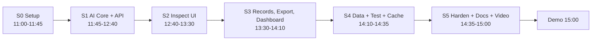

# AOI-Lite Batam: Sprint Plan (31 Oct 2026, 11:00 to 15:00 WIB)

> Context: [PROJECT_CONTEXT.md](PROJECT_CONTEXT.md) · Done criteria: [DEFINITION_OF_DONE.md](DEFINITION_OF_DONE.md) · Live tracker: [PROGRESS.md](PROGRESS.md)
>
> Legend: `[ ]` todo · `[~]` in progress · `[x]` done · `[-]` dropped / out of scope
> **Rule:** a sprint isn't closed until its exit criteria pass. If a sprint overruns by more than 10 min, cut the 🟡 items first, then the 🟢 items. 🔴 items are never cut.
> Priority: 🔴 must-have (Definition of Done) · 🟡 should-have · 🟢 nice-to-have

## Timeline overview

| Sprint | Window | Goal | DMAIC link |
|---|---|---|---|
| S0 | 11:00–11:45 | Repo, docs, env, prompt, schema, sample data ready | Define |
| S1 | 11:45–12:40 | Gemma 4 returns validated JSON through the API, stored in SQLite | Improve |
| S2 | 12:40–13:30 | Full Capture → Analyze → Review → Confirm flow in the browser | Improve |
| S3 | 13:30–14:10 | Records list, CSV/JSON export, dashboard KPIs | Measure / Analyze |
| S4 | 14:10–14:35 | 10–20 image test run, offline cache, evaluation numbers | Measure / Control |
| S5 | 14:35–15:00 | README, architecture, demo script, backup video, push public | Control |
| Freeze | **14:30** | No new features after this point. Fixes only | |

---

## Sprint 0: Alignment and repository setup (11:00–11:45)
**Goal:** everyone works from the same context, and the repo skeleton runs.

### 0.1 Context and planning docs
- [x] 🔴 Read the Project Brief and extract the 10-point summary (`plan.md` artifact)
- [x] 🔴 `docs/PROJECT_CONTEXT.md` as the single source of truth
- [x] 🔴 `docs/SPRINT_PLAN.md` (this file)
- [x] 🔴 `docs/DEFINITION_OF_DONE.md`
- [x] 🔴 `docs/PROGRESS.md`
- [x] 🔴 `docs/architecture.md`, `docs/DMAIC.md`, `docs/DEMO_SCRIPT.md`, `docs/EVALUATION.md`
- [x] 🔴 Answer the blocking questions (API key configured, Kaggle `akhatova/pcb-defects` attributed, `gemma-4-26b-a4b-it` selected)

### 0.2 Repository skeleton (Unified Next.js Full-Stack SPA on Vercel)
- [x] 🔴 Folder structure: `src/app/` (SPA + API Route Handlers), `src/lib/` (config, schema, gemma, storage), `public/samples/`, `sample_data/`, `scripts/`, `docs/`
- [ ] 🔴 `package.json`, `tsconfig.json`, `next.config.mjs`, `postcss.config.mjs` (Next.js + React + TypeScript + Tailwind CSS)
- [x] 🔴 `LICENSE` (MIT)
- [x] 🔴 `.gitignore` (`node_modules/`, `.next/`, `.vercel/`, `.env`, `data/`)
- [x] 🔴 `.env.example` (`GEMINI_API_KEY`, `GEMMA_MODEL_ID`, `AI_MODE`, `CONFIDENCE_THRESHOLD`, `SUPABASE_URL`, `SUPABASE_KEY`)
- [x] 🔴 `README.md` with full setup, Vercel deployment, architecture, schema, DMAIC, and MLH disclosures
- [x] 🔴 `sample_data/DATA_SOURCES.md`
- [ ] 🔴 `git init` + first commit
- [ ] 🔴 Create the public GitHub repo `aoi-lite-batam` and push

### 0.3 Environment
- [ ] 🔴 `npm install` succeeds in `project/`
- [x] 🔴 `.env` created locally with valid `GEMINI_API_KEY` and `SUPABASE_URL` / `SUPABASE_KEY` (never committed)

### 0.4 AI contract
- [x] 🔴 Prompt `prompts/inspection_prompt_v1.txt` (version `aoi-prompt-v1.0`)
- [ ] 🔴 `src/lib/config.ts`: env loading, threshold, prompt SHA, demo operators/lines
- [ ] 🔴 `src/lib/schema.ts`: strict TypeScript + Zod runtime validator, 6-class enum, review payloads, deterministic safety rules

### 0.5 Sample data
- [ ] 🔴 `scripts/prepare_samples.py`: pick 2 images per PKU class (12) + 4 clean `PCB_USED` boards (golden) + 4 procedural SMT defect cards, resize to ≤1600 px into `public/samples/`
- [ ] 🔴 `sample_data/labels.json`: original class, mapped class, scaled bounding boxes, quadrant hint
- [x] 🔴 `sample_data/DATA_SOURCES.md`: source, license, mapping, bare-PCB limitation

**Exit criteria S0:** Next.js app initializes · prompt and schema ready · ≥16 sample images in `public/samples/` with `labels.json`.

---

## Sprint 1: AI core and Next.js Serverless API Routes (12:00–12:45)
**Goal:** Next.js Route Handler `POST /api/analyze` returns validated, guard-railed Gemma 4 JSON and creates a pending record in Supabase PostgreSQL.

### 1.1 Gemma 4 client (`src/lib/gemma.ts`)
- [ ] 🔴 `buildPrompt()` injects metadata and threshold into the template
- [ ] 🔴 `callGemma()`: REST `models/{GEMMA_MODEL_ID}:generateContent` with inline JPEG + prompt, `temperature 0.1`
- [ ] 🔴 Skip `thought` parts and keep only the answer text
- [ ] 🔴 `extractJson()`: strip code fences, take the first `{…}` block
- [ ] 🔴 `validateInspectionResult()`: strict schema validator. Classes outside the 6 fail validation
- [ ] 🔴 Retry **once**, sending the validation error back to the model
- [ ] 🔴 After 2 failures: status `manual_required`. Keep the raw text and errors
- [ ] 🔴 Distinguish `GemmaUnavailable` (network/auth/quota) from invalid output
- [ ] 🔴 **Smoke test:** one real call with one sample image returns valid JSON *(verify `gemma-4-26b-a4b-it` works)*

### 1.2 Safety rules (deterministic, after validation)
- [ ] 🔴 Force `model="gemma-4-multimodal"` and `operator_confirmation_required=true`
- [ ] 🔴 Overwrite `board_id` / `inspection_id` with the server values
- [ ] 🔴 Any defect with confidence below the threshold sets `requires_human_verification` and adds a routing reason
- [ ] 🔴 `image_quality ≠ acceptable` sets `requires_human_verification`
- [ ] 🔴 AI `pass` with defects listed is flagged as inconsistent and routed
- [ ] 🔴 Store `original_ai_disposition` separately from the routed one

### 1.3 Offline fallback
- [ ] 🔴 `AI_MODE = auto | live | offline`
- [ ] 🔴 Every successful live call on a sample image saves `sample_data/cached_responses/<sample_id>.json` (real output, model ID, prompt version, timestamp)
- [ ] 🔴 If the API is unavailable and a cache exists: replay it with `source="cached"` (badged in the UI)
- [ ] 🔴 If the API is unavailable and there's no cache: `manual_required`

### 1.4 Client & Server Image Pre-processing
- [ ] 🔴 Client-side HTML5 `<canvas>` normalizes uploaded/captured images to ≤1600 px JPEG (q=0.85) so payloads fit cleanly within Vercel serverless limits
- [ ] 🔴 SHA-256 of the image bytes computed via Web Crypto / Node `crypto` (audit trail)
- [ ] 🟡 Brightness (mean luminance) pre-check stored as `precheck`

### 1.5 Storage (`src/lib/storage.ts`, Supabase PostgreSQL + Local Fallback)
- [ ] 🔴 Supabase migration `create_aoi_inspections` applied to `public.aoi_inspections` (project `rrkafcbuhnnwnduvwluq`)
- [ ] 🔴 Columns: id, created_at, shift, metadata fields, image_filename, image_sha256, sample_id, reference_label, precheck, ai_source, model_id, prompt_version, prompt_sha, ai_raw_text, ai_result, ai_attempts, ai_latency_ms, ai_errors, routing_reasons, original_ai_disposition, status, final_defects, defect_reviews, final_disposition, reviewer_id, reviewed_at, human_agreement, review_notes, doc_time_s, started_at
- [ ] 🔴 Automatic local JSON/in-memory fallback (`data/local_records.json`) so offline mode continues to work if internet drops
- [ ] 🔴 Inspection ID format `INS-YYYYMMDD-HHMMSS-xxxx`
- [ ] 🔴 Shift derived from the timestamp (A 07–15, B 15–23, C 23–07)

### 1.6 Next.js Route Handlers (`src/app/api/*/route.ts`, Vercel-ready)
- [ ] 🔴 `GET /api/config`: model, prompt version, threshold, classes, operators, lines, types, AI mode, Supabase status
- [ ] 🔴 `GET /api/samples`: gallery list (+ reference label for evaluation mode)
- [ ] 🔴 `POST /api/analyze`: creates a `pending_review` record in Supabase (and local mirror) and returns the AI outcome
- [ ] 🔴 `POST /api/inspections/[id]/review`: human decision (see S2.4 rules)
- [ ] 🔴 `GET /api/inspections`, `GET /api/inspections/[id]`
- [ ] 🔴 `GET /api/export/csv`, `GET /api/export/json`
- [ ] 🔴 `GET /api/stats`

**Exit criteria S1:** a request to `/api/analyze` with a sample image returns valid JSON from **live Gemma 4** and a pending row exists in **Supabase PostgreSQL** (`public.aoi_inspections`). Invalid output → retry → manual path tested with a forced bad string.

---

## Sprint 2: Next.js Single-Page Application UI (`src/app/page.tsx`) (12:45–13:30)
**Goal:** an inspector completes Capture → Analyze → Review → Confirm in ≤5 interactions inside the unified Next.js (App Router + TypeScript + Tailwind CSS) Single-Page Application.

### 2.1 Layout and design system (`docs/DESIGN.md` — IBM Carbon Design System)
- [x] 🔴 IBM Carbon Design System aesthetic (`docs/DESIGN.md`): pure white canvas (`#ffffff`), light gray surface (`#f4f4f4`), charcoal ink (`#161616`), single assertive IBM Blue accent (`#0f62fe`), flat-square `0px` corners (`rounded-none`), 1px `#e0e0e0` hairlines, no drop shadows, `IBM Plex Sans` (`300` display / `400` body with `0.16px` tracking / `600` emphasis), `>=48px` touch targets, and `#161616` inverted charcoal footer
- [ ] 🔴 Persistent banner: **"AI assistance only. Final quality disposition requires human verification."**
- [ ] 🔴 Top tabs: **Inspect · Records · Dashboard**
- [ ] 🔴 Stepper: Capture → Analyze → Review → Confirm → Export
- [ ] 🔴 Status chips with distinct Carbon semantic colour **and** text: `AI-SUGGESTED` (`#f1c21b` warning) · `HUMAN-CONFIRMED` (`#24a148` success) · `REJECTED` (`#da1e28` error) · `ESCALATED` (`#f1c21b`) · `PENDING REVIEW` (`#e0e0e0`) · `MANUAL ENTRY` (`#0f62fe` info)
- [ ] 🟡 Inverted charcoal footer (`#161616`): model ID · prompt version · threshold · AI mode · Supabase status

### 2.2 Step 1: Capture
- [ ] 🔴 **Sample gallery first** (thumbnails, works offline)
- [ ] 🔴 File upload (`accept="image/*"`)
- [ ] 🔴 Camera: `getUserMedia` live preview + capture button
- [ ] 🔴 Camera fallback: `<input capture="environment">` if getUserMedia fails
- [ ] 🔴 Image preview + start doc-time timer on selection
- [ ] 🔴 Privacy reminder: "Do not upload confidential customer boards"

### 2.3 Step 2: Metadata and analyze
- [ ] 🔴 Board ID (pre-filled for samples), revision, line/station select, operator select, inspection type select
- [ ] 🔴 Big **Analyze with Gemma 4** button, disabled until image + required fields are filled
- [ ] 🔴 Loading state with elapsed seconds (expected 10–20 s)
- [ ] 🔴 Error state: offers **Retry** or **Manual entry**

### 2.4 Step 3: Review (AI result card)
- [ ] 🔴 Header: `AI-SUGGESTED` chip, source badge (`LIVE GEMMA 4` / `CACHED GEMMA 4 OUTPUT` / `MANUAL`), latency, attempts
- [ ] 🔴 Image quality, suggested disposition, routing reasons (why human verification is needed)
- [ ] 🔴 Per defect: class, location hint, **confidence bar + number** (red below the threshold), severity, evidence, recommended action
- [ ] 🔴 Per-defect buttons: **Accept · Edit · Reject · Escalate**
- [ ] 🔴 Edit mode: class dropdown (6 classes only), severity, location
- [ ] 🔴 **+ Add missed defect** (human-found, counts toward recall)
- [ ] 🔴 "No defects suggested" state: explicit message + human must still confirm
- [ ] 🟡 Visible labels (OCR) chips and model notes
- [ ] 🟡 Collapsible raw JSON (transparency for judges)
- [ ] 🟢 X-ray note: "Hidden joints (BGA/QFN voids, HiP) not assessed; requires X-ray"

### 2.5 Step 4: Confirm
- [ ] 🔴 Final disposition selector (human only): `pass · rework · quarantine · escalate`
- [ ] 🔴 Reviewer ID (defaults to operator) + notes
- [ ] 🔴 Confirm is blocked until every AI defect has an action and a disposition is chosen
- [ ] 🔴 Server computes `human_agreement`:
  - `agree`: all accepted, nothing added
  - `disagree`: all rejected, or AI found nothing and the human added defects
  - `partial`: anything else
- [ ] 🔴 Save → success screen with a `HUMAN-CONFIRMED` chip + record ID + doc time

### 2.6 Step 5: Export (from the success screen)
- [ ] 🔴 Buttons: Download this record (JSON) · Go to Records · **New inspection**

### 2.7 Manual entry path
- [ ] 🔴 Shown when AI is unavailable or invalid after retry. Same review UI with an empty AI list and `MANUAL ENTRY` badge
- [ ] 🔴 Record saved with `ai_source="manual"` + error reason

**Exit criteria S2:** a sample image runs end-to-end in the browser with a live Gemma 4 call, and the confirmed record appears in SQLite with AI output and the human decision stored separately.

---

## Sprint 3: Records, export, dashboard (13:30–14:10)
**Goal:** structured data visibly enables DMAIC Measure and Analyze.

### 3.1 Records tab
- [ ] 🔴 Table: time, inspection ID, board, operator, line, AI suggestion, final disposition, status chip, agreement
- [ ] 🔴 Click a row to see the detail: image, AI JSON (original), human decision, audit fields (hash, model, prompt version)
- [ ] 🟡 Filter: status (pending / confirmed / escalated)
- [ ] 🟡 Resume a pending review from the record

### 3.2 Export
- [ ] 🔴 CSV: **one row per defect** (Pareto-ready); inspections without defects get one row. Columns: inspection_id, created_at, shift, board_id, board_revision, line_station, operator_id, inspection_type, image_filename, image_sha256, model_id, prompt_version, ai_source, ai_overall_disposition, ai_defect_class, ai_confidence, ai_severity, ai_location_hint, ai_evidence, human_action, final_defect_class, final_severity, final_disposition, human_agreement, reviewer_id, reviewed_at, doc_time_s, status
- [ ] 🔴 JSON: full records including the original AI output and the human decision
- [ ] 🔴 Export buttons on the Records and Dashboard tabs

### 3.3 Dashboard (CSS bars, no chart library, so it works offline)
- [ ] 🔴 KPI tiles: total inspections · **pending human reviews** · confirmed · escalated
- [ ] 🔴 **Defect distribution** by confirmed class (Pareto, sorted)
- [ ] 🔴 AI quality: precision (accepted / reviewed flags), **false-call rate** (rejected / flags), recall proxy, agreement rate
- [ ] 🔴 Traceability completeness %
- [ ] 🟡 Average documentation time (s)
- [ ] 🟡 Breakdown by severity, line, operator, shift, board
- [ ] 🟡 Final disposition distribution
- [ ] 🟢 AI vs human side-by-side class counts
- [ ] 🔴 Disclaimer under the KPIs: "Demo sample set: not a factory-wide capability study"

**Exit criteria S3:** after 3+ confirmed records, CSV opens in Excel with correct columns, JSON contains AI + human data, and the dashboard numbers match the records.

---

## Sprint 4: Data, testing, offline cache (14:10–14:35)
**Goal:** demo works with no internet, and we have honest numbers.

### 4.1 Test run
- [ ] 🔴 Run all 16+ sample images through live Gemma 4 (`scripts/evaluate.py` or via the UI)
- [ ] 🔴 Every sample has a cached real Gemma output in `sample_data/cached_responses/`
- [ ] 🔴 `scripts/evaluate.py`: per-image AI classes vs reference label, per-class TP/FP/FN, precision/recall, JSON-valid rate, retries, avg latency, written to `docs/EVALUATION.md`
- [ ] 🔴 Review at least 10 records through the UI (mix of accept / edit / reject / escalate) so the dashboard is populated

### 4.2 Failure-path tests
- [ ] 🔴 `AI_MODE=offline` → sample analyze uses the cache, badge shows CACHED
- [ ] 🔴 Invalid API key → falls back to cache / manual, no crash
- [ ] 🔴 Upload a non-sample image while offline → manual entry
- [ ] 🔴 Camera denied → file-input fallback works
- [ ] 🟡 Blurry / dark image → `image_quality` poor → routed
- [ ] 🟡 Phone/tablet layout check (Chrome device mode)

### 4.3 Prompt tuning (only if time allows)
- [ ] 🟡 If the false-call rate is very high on clean golden boards: adjust prompt v1.1, bump `PROMPT_VERSION`, re-run, record before/after in EVALUATION.md (Control-phase story)

**Exit criteria S4:** offline demo works with Wi-Fi off · EVALUATION.md has real numbers · ≥10 human-reviewed records exist.

---

## Sprint 5: Hardening, docs, submission (14:35–15:00)
**Goal:** public, reproducible, demo-ready.

### 5.1 Repository docs
- [ ] 🔴 `README.md`: pitch, problem, features, screenshots, **architecture diagram**, setup (≤5 commands), `.env` config, model + prompt version, JSON schema, HITL rules, DMAIC mapping, KPIs, limitations (not AOI replacement, X-ray note, bare-PCB dataset), data sources, license, **AI tools disclosure**, roadmap
- [ ] 🔴 `docs/architecture.md` (mermaid)
- [ ] 🔴 `docs/DEMO_SCRIPT.md` (90 s live script + 2 min video script)
- [ ] 🟡 `docs/DMAIC.md`
- [ ] 🔴 `LICENSE` (MIT) present

### 5.2 Demo prep
- [ ] 🔴 Reset the DB, then preload 5–8 reviewed records so the dashboard isn't empty
- [ ] 🔴 Pick 3 demo images: clean golden board, short/bridge, uncertain anomaly
- [ ] 🔴 Record a **backup demo video ≤2 min**, opening with *"Hi, I'm …, and this is my demo for Hacktoberfest Hack Day Kota Batam x Batam Innovation Center."*
- [ ] 🔴 Rehearse the 90 s live demo once

### 5.3 Submission
- [ ] 🔴 Final commit + push. Repo is **public**
- [ ] 🔴 Upload the video publicly (YouTube unlisted/public)
- [ ] 🔴 OrganizerHQ submission: name, both prize categories, model (Gemma 4 via Gemini API), AI coding tools used, repo URL, video URL, license, data-source statement
- [ ] 🔴 **Stop hacking at 15:00**

**Exit criteria S5:** every item in [DEFINITION_OF_DONE.md](DEFINITION_OF_DONE.md) Section 1 is checked.

---

## Cut list (in this order if behind schedule)
1. 🟢 items (side-by-side charts, X-ray note card)
2. Prompt tuning v1.1
3. Breakdown charts by line/operator/shift (keep in the CSV only)
4. Records filter / resume pending
5. Blur pre-check
6. Live camera preview (keep the `<input capture>` fallback)

**Never cut:** sample gallery, live Gemma 4 call, strict validation + retry + manual, human review with accept/edit/reject/escalate, record storage, CSV/JSON export, basic dashboard, README + license, banner.
