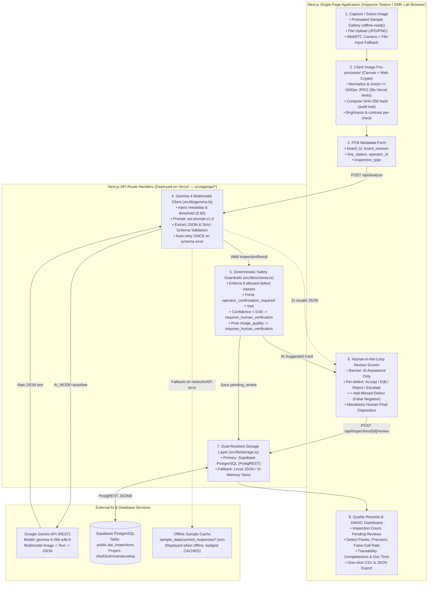
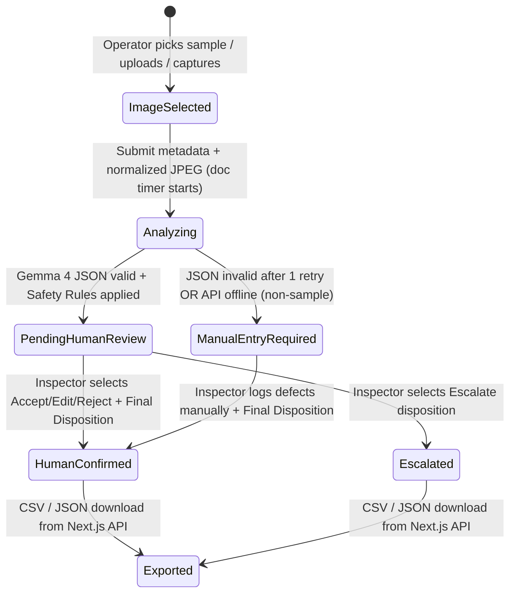

# System Architecture — AOI-Lite Batam

> **Core Stack (Unified Next.js Full-Stack SPA on Vercel):**
> - **Frontend & Backend:** **Next.js** (App Router, React, TypeScript, Tailwind CSS) — Single-Page Application (SPA) UI + Serverless API Route Handlers (`src/app/api/*`)
> - **Cloud Hosting:** **Vercel** (zero-config deployment for both UI and API routes)
> - **Database:** **Supabase** (PostgreSQL table `public.aoi_inspections` via PostgREST + automatic local fallback)
> - **AI Model:** Open-weight **Google Gemma 4 (`gemma-4-26b-a4b-it`)** multimodal via the Gemini API

---

## 1. End-to-End Architecture Diagram



---

## 2. State Machine for an Inspection Record



---

## 3. Unified Next.js Project Structure & Responsibilities

| Module / Route | File Path | Responsibility |
|---|---|---|
| **Configuration & Versioning** | `src/lib/config.ts` | Reads environment variables (`GEMINI_API_KEY`, `GEMMA_MODEL_ID=gemma-4-26b-a4b-it`, `CONFIDENCE_THRESHOLD=0.60`, `SUPABASE_URL`, `SUPABASE_KEY`), computes `PROMPT_SHA256`, defines demo operators/stations. |
| **Prompt Template** | `prompts/inspection_prompt_v1.txt` | Constrained multimodal system instructions, 6-class visual definitions, X-ray exclusion rule, strict JSON output contract. |
| **Strict Schema & Guardrails** | `src/lib/schema.ts` | TypeScript + runtime strict validator enforcing the 6 `DefectClass` literals, `Severity`, `ImageQuality`, `AIDisposition`, human `FinalDisposition`, and `applySafetyRules()`. |
| **Gemma 4 Multimodal Client** | `src/lib/gemma.ts` | Calls `models/gemma-4-26b-a4b-it:generateContent`, strips markdown fences, validates schema, retries once with validation feedback, manages offline sample cache (`sample_data/cached_responses/`). |
| **Supabase + Local Persistence** | `src/lib/storage.ts` | Reads/writes `public.aoi_inspections` in Supabase PostgreSQL via PostgREST (and mirrors locally for offline safety), computes DMAIC dashboard statistics, formats CSV/JSON exports. |
| **Next.js API Route Handlers** | `src/app/api/config/route.ts`<br/>`src/app/api/samples/route.ts`<br/>`src/app/api/analyze/route.ts`<br/>`src/app/api/inspections/route.ts`<br/>`src/app/api/inspections/[id]/review/route.ts`<br/>`src/app/api/stats/route.ts`<br/>`src/app/api/export/csv/route.ts`<br/>`src/app/api/export/json/route.ts` | Serverless backend endpoints deployed alongside the SPA on Vercel. Zero CORS issues! |
| **Single-Page Application UI** | `src/app/page.tsx`<br/>`src/app/layout.tsx`<br/>`src/app/globals.css` | Industrial dark SPA with 5-step inspection workflow (`Capture -> Analyze -> Review -> Confirm -> Export`), confidence bars, per-defect review controls, records browser, and DMAIC dashboard. |

---

## 4. Supabase Database Schema (`public.aoi_inspections`)

```sql
CREATE TABLE IF NOT EXISTS public.aoi_inspections (
  id TEXT PRIMARY KEY,
  created_at TIMESTAMPTZ NOT NULL DEFAULT now(),
  shift TEXT NOT NULL,
  board_id TEXT NOT NULL,
  board_revision TEXT NOT NULL DEFAULT 'A',
  line_station TEXT NOT NULL,
  operator_id TEXT NOT NULL,
  inspection_type TEXT NOT NULL DEFAULT 'post_reflow',
  image_filename TEXT,
  image_sha256 TEXT,
  sample_id TEXT,
  reference_label TEXT,
  precheck JSONB DEFAULT '{}'::jsonb,
  ai_source TEXT NOT NULL,
  model_id TEXT NOT NULL,
  prompt_version TEXT NOT NULL,
  prompt_sha TEXT NOT NULL,
  ai_raw_text TEXT,
  ai_result JSONB,
  ai_attempts INT NOT NULL DEFAULT 0,
  ai_latency_ms INT NOT NULL DEFAULT 0,
  ai_errors JSONB DEFAULT '[]'::jsonb,
  routing_reasons JSONB DEFAULT '[]'::jsonb,
  original_ai_disposition TEXT,
  status TEXT NOT NULL DEFAULT 'pending_review',
  final_defects JSONB,
  defect_reviews JSONB,
  final_disposition TEXT,
  reviewer_id TEXT,
  reviewed_at TIMESTAMPTZ,
  human_agreement TEXT,
  review_notes TEXT,
  doc_time_s DOUBLE PRECISION,
  started_at TEXT
);
```
